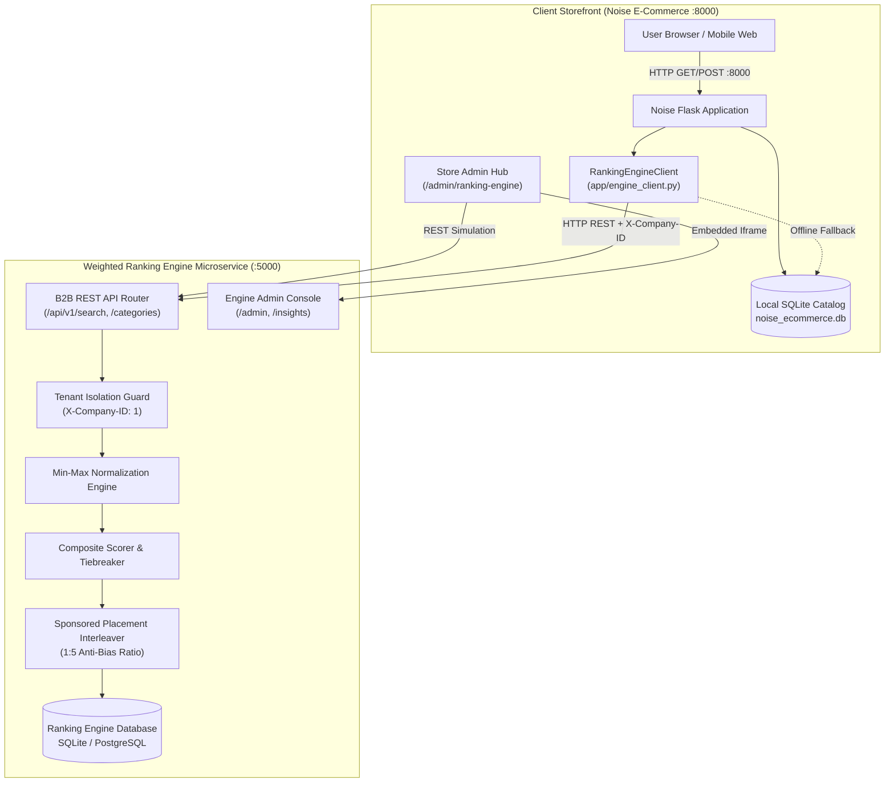
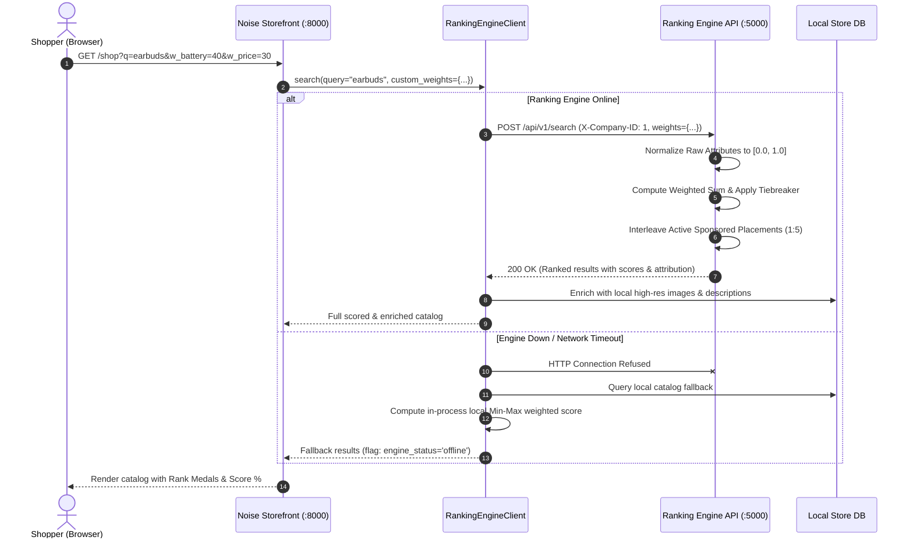

# Enterprise Integration Guide — Weighted Ranking Engine (B2B SaaS)

> **The Definitive Blueprint for Integrating Any E-Commerce Platform with the Weighted Ranking Engine.**  
> Transform basic product listings into deterministic, multi-criteria AI recommendations with transparent customer personalization, sponsored placement controls, and embedded administrative governance.

---

## 📑 Table of Contents

1. [Executive Overview: Why Weighted Ranking Over Simple Sorting](#1-executive-overview)
2. [End-to-End System Architecture](#2-system-architecture)
   - [Component Topology Diagram](#component-topology-diagram)
   - [Runtime Request Flow (Sequence Diagram)](#runtime-request-flow-sequence-diagram)
3. [Step 1: Provisioning Company Tenant & API Credentials](#step-1-provisioning-company-tenant--api-credentials)
4. [Step 2: Defining Schema, Attributes & Bounds](#step-2-defining-schema-attributes--bounds)
   - [Continuous vs Binary Metrics](#continuous-vs-binary-metrics)
   - [Directionality: Lower-is-Better vs Higher-is-Better](#directionality-lower-is-better-vs-higher-is-better)
   - [100% Weight Allocation Rule](#100-weight-allocation-rule)
5. [Step 3: Catalog Synchronization & Score Computation](#step-3-catalog-synchronization--score-computation)
   - [Min-Max Normalization Formula](#min-max-normalization-formula)
   - [Composite Scorer Formula](#composite-scorer-formula)
6. [Step 4: Implementing the Search & Discovery Frontend](#step-4-implementing-the-search--discovery-frontend)
   - [Standard Multi-Criteria Search](#standard-multi-criteria-search)
   - [Interactive Customer Personalization Sliders (Smart Tuner)](#interactive-customer-personalization-sliders-smart-tuner)
   - [Sponsored Placement Interleaving & Anti-Bias Verification](#sponsored-placement-interleaving--anti-bias-verification)
7. [Step 5: Score Breakdown & Algorithmic Transparency ("Why Ranked #X")](#step-5-score-breakdown--algorithmic-transparency-why-ranked-x)
8. [Step 6: Integrating the Engine Admin Console into Your Store Admin](#step-6-integrating-the-engine-admin-console-into-your-store-admin)
   - [Embedded Sandboxed Iframe Hub](#embedded-sandboxed-iframe-hub)
   - [Native REST API Query Simulator](#native-rest-api-query-simulator)
9. [Step 7: Search Telemetry & Analytics](#step-7-search-telemetry--analytics)
10. [Step-by-Step Code Examples](#step-by-step-code-examples)
    - [Python / Flask Client Implementation](#python--flask-client-implementation)
    - [JavaScript / Browser Dynamic Re-Ranking](#javascript--browser-dynamic-re-ranking)
    - [cURL Automated Testing Payload](#curl-automated-testing-payload)
11. [Visual UI Mockups & Architectural Layouts](#visual-ui-mockups--architectural-layouts)

---

## 1. Executive Overview

### The Limitation of Traditional Database Sorting
Most e-commerce storefronts rely on naive SQL queries:
```sql
SELECT * FROM products WHERE category = 'Earbuds' ORDER BY price ASC;
-- OR
SELECT * FROM products WHERE category = 'Earbuds' ORDER BY rating DESC;
```

This 1-dimensional sorting introduces critical business flaws:
1. **Unbalanced Results**: Sorting by lowest price surfaces cheap, low-battery products with poor user reviews.
2. **Feature Cannibalization**: Sorting by rating ignores price, pushing high-end items beyond the customer's budget.
3. **No Personalization**: Every customer sees the identical order regardless of whether they need long battery life or budget pricing.
4. **Sponsor Distrust**: Hardcoded banner ads feel intrusive, while undisclosed sponsored results erode customer trust.

### The Weighted Ranking Engine Solution
The **Weighted Ranking Engine** evaluates all key product attributes simultaneously using mathematical normalization and configurable category weights:

$$\text{Composite Score} = \sum_{i=1}^{n} \Big( \text{Normalized}(A_i) \times \frac{W_i}{100} \Big)$$

- **Multi-Attribute Optimization**: Evaluates battery endurance, price competitiveness, customer reviews, and hardware capabilities (e.g. ANC) simultaneously.
- **Dynamic Customer Tuner**: Shoppers can adjust importance weights via intuitive sliders to match their individual buying priorities.
- **Controlled Monetization**: Promotes sponsored products without corrupting organic ranking algorithms, enforcing a strict $1:5$ interleaving ratio with transparent badges.
- **Resilient Multi-Tenancy**: Isolated tenant sandboxing with zero cross-tenant data leakage.

---

## 2. System Architecture

### Component Topology Diagram



---

### Runtime Request Flow (Sequence Diagram)



---

## 3. Step 1: Provisioning Company Tenant & API Credentials

Every e-commerce platform connects to the engine as an isolated **Tenant Company**.

### Tenant Provisioning Workflow
1. The **Platform Superadmin** provisions a tenant via the Ranking Engine Admin Console (`http://localhost:5000/admin/company/new`).
2. An organization ID is generated (e.g. `company_id = 1` for Noise / TechMart Electronics).
3. The platform creates manager credentials for your store's engineering team:
   - **Username**: `techmart_admin`
   - **Email**: `admin@techmart.com`
   - **Password**: `company123`

### Client Configuration (`config.py`)
Store these credentials in your e-commerce application configuration:

```python
# E-Commerce Site config.py
class BaseConfig:
    RANKING_ENGINE_URL = os.environ.get('RANKING_ENGINE_URL', 'http://localhost:5000')
    RANKING_COMPANY_ID = int(os.environ.get('RANKING_COMPANY_ID', '1'))
    RANKING_TIMEOUT = 3.0  # seconds before fallback activates
```

---

## 4. Step 2: Defining Schema, Attributes & Bounds

Before ranking products, the tenant defines its catalog categories and scoring attributes within the engine.

### Continuous vs Binary Metrics
The engine supports two distinct attribute data types:

| Metric Type | Example Attributes | Data Type | Min / Max Values |
|---|---|---|---|
| **Continuous Numeric** | Battery Life (hours) | `numeric` | `min: 0.0, max: 40.0` |
| **Continuous Numeric** | Price (INR) | `numeric` | `min: 500.0, max: 15000.0` |
| **Continuous Numeric** | Customer Rating | `numeric` | `min: 0.0, max: 5.0` |
| **Discrete Binary** | Active Noise Cancelling | `binary` | `min: 0.0, max: 1.0` (1 = Yes, 0 = No) |

### Directionality: Lower-is-Better vs Higher-is-Better
- **Higher-is-Better (`lower_is_better = False`)**: Used for metrics where larger numbers are superior (e.g., Battery Life, Warranty, Review Rating).
- **Lower-is-Better (`lower_is_better = True`)**: Used for cost and penalty metrics (e.g., Price, Latency, Weight). A lower price earns a higher normalized score.

### The 100% Weight Allocation Rule
For any category, the sum of active attribute weights **must equal exactly 100.0%**:

$$W_{\text{Battery}} + W_{\text{Price}} + W_{\text{Rating}} + W_{\text{ANC}} = 35\% + 35\% + 15\% + 15\% = 100.0\%$$

The engine strictly rejects custom weight sets whose sum deviates by more than $\pm 0.05\%$.

---

## 5. Step 3: Catalog Synchronization & Score Computation

### Min-Max Normalization Formula
Raw metric values have completely different units (hours vs rupees vs star counts). The engine normalizes every raw value $V$ into a standardized float between $0.00$ and $1.00$.

#### Case 1: Higher is Better (`lower_is_better = False`)
$$S_{\text{norm}} = \frac{V - V_{\min}}{V_{\max} - V_{\min}}$$

*Example*: Battery life = 30 hours, Scale = [0, 40]:
$$S_{\text{norm}} = \frac{30 - 0}{40 - 0} = \frac{30}{40} = 0.75$$

#### Case 2: Lower is Better (`lower_is_better = True`)
$$S_{\text{norm}} = \frac{V_{\max} - V}{V_{\max} - V_{\min}}$$

*Example*: Earbuds Price = ₹2,799, Scale = [500, 15000]:
$$S_{\text{norm}} = \frac{15000 - 2799}{15000 - 500} = \frac{12201}{14500} \approx 0.8414$$

#### Case 3: Binary Criteria (`data_type = 'binary'`)
$$S_{\text{norm}} = 1.0 \quad (\text{if Yes/True}), \qquad S_{\text{norm}} = 0.0 \quad (\text{if No/False})$$

---

### Composite Scorer Formula
Once all attributes are normalized, the engine computes the overall composite score:

$$\text{Composite Score} = \sum_{i=1}^{n} \left( S_{\text{norm}, i} \times \frac{W_i}{100} \right)$$

#### Sample Product Scoring Calculation (OnePlus Nord Buds 2):
| Attribute | Raw Value | Min - Max | Direction | $S_{\text{norm}}$ | Weight | Contribution |
|---|---|---|---|---|---|---|
| Battery Life | 36 hrs | 0 – 40 | Higher | 0.9000 | 35% | 0.3150 |
| Price (INR) | ₹2,799 | 500 – 15000 | Lower | 0.8414 | 35% | 0.2945 |
| Rating | 4.0 | 0 – 5.0 | Higher | 0.8000 | 15% | 0.1200 |
| ANC | Yes (1.0) | 0 – 1.0 | Higher | 1.0000 | 15% | 0.1500 |
| **Total** | — | — | — | — | **100%** | **0.8795 (88.0%)** |

---

## 6. Step 4: Implementing the Search & Discovery Frontend

### Standard Multi-Criteria Search
When a shopper visits your store's catalog page, dispatch a request to the engine client:

```python
# In your storefront route handler
@storefront.route('/shop')
def shop():
    q = request.args.get('q', '').strip()
    category_id = get_category_id_by_name(request.args.get('category'))
    
    # Query engine client
    results = engine_client.search(query=q, category_id=category_id, limit=20)
    return render_template('shop.html', products=results['results'])
```

---

### Interactive Customer Personalization Sliders (Smart Tuner)
Allow customers to dynamically tune the algorithm. The tuner drawer renders 4 sliders linked to the category's active attributes.

```html
<!-- HTML Snippet: Tuner Drawer Sliders -->
<div class="slider-group">
  <div class="slider-label-row">
    <span>Battery Life Priority</span>
    <span id="val_battery">35%</span>
  </div>
  <input type="range" min="0" max="100" step="5" value="35" class="weight-slider" data-attr="Battery Life (hours)">
</div>

<div class="slider-group">
  <div class="slider-label-row">
    <span>Price Economy Priority</span>
    <span id="val_price">35%</span>
  </div>
  <input type="range" min="0" max="100" step="5" value="35" class="weight-slider" data-attr="Price (INR)">
</div>
```

When sliders change, JavaScript recalculates the total:

```javascript
// Validate 100% sum and submit AJAX request
async function applyTunerWeights(customWeights) {
  const sum = Object.values(customWeights).reduce((a, b) => a + b, 0);
  if (Math.abs(sum - 100.0) > 0.1) {
    alert("Weights must total exactly 100%!");
    return;
  }

  const res = await fetch('/api/smart-rank', {
    method: 'POST',
    headers: { 'Content-Type': 'application/json' },
    body: JSON.stringify({ category_id: 1, custom_weights: customWeights })
  });
  const data = await res.json();
  renderProductsGrid(data.products);
}
```

---

### Sponsored Placement Interleaving & Anti-Bias Verification
To balance monetization with organic integrity:
1. **1:5 Capped Slot Ratio**: For every 5 organic products, the engine interleaves at most **1 sponsored product**.
2. **Prominent Disclosure**: Products placed via sponsorship receive the `is_sponsored: true` flag. Render a high-visibility badge:
   ```html
   
     <span class="badge-sponsored">⭐ SPONSORED</span>
   
     <span class="badge-rank">#{{ product.rank }}</span>
   
   ```
3. **No Hidden Score Manipulation**: The product's actual composite score remains untouched. Customers can inspect the mathematical score to verify organic ranking performance independently of the sponsored boost.

---

## 7. Step 5: Score Breakdown & Algorithmic Transparency ("Why Ranked #X")

To eliminate consumer skepticism, every product card and detail page should provide an attribution popup or widget.

### Visual Attribute Breakdown Widget
```html
<div class="score-breakdown-card">
  <h4>Why is this product ranked #{{ product.rank }}?</h4>
  <div class="composite-gauge">
    Overall Match Score: <strong>{{ product.score_pct }}</strong>
  </div>
  
  <table class="breakdown-table">
    <thead>
      <tr>
        <th>Attribute</th>
        <th>Raw Value</th>
        <th>Normalized</th>
        <th>Weight</th>
        <th>Contribution</th>
      </tr>
    </thead>
    <tbody>
      
      <tr>
        <td>{{ item.attribute_name }}</td>
        <td>{{ item.raw_value }}</td>
        <td>{{ (item.normalized_value * 100)|round(1) }}%</td>
        <td>{{ item.weight }}%</td>
        <td><strong>+{{ (item.weighted_score * 100)|round(2) }} pts</strong></td>
      </tr>
      
    </tbody>
  </table>
</div>
```

---

## 8. Step 6: Integrating the Engine Admin Console into Your Store Admin

Store administrators must have seamless control over weights, active categories, and campaign sponsorships without logging into separate infrastructure.

### Embedded Sandboxed Iframe Hub
Embed the Weighted Ranking Engine directly within your store's admin console (`/admin/ranking-engine`):

```html
<div class="engine-iframe-wrapper">
  <div class="iframe-browser-bar">
    <span class="browser-address" id="browserAddress">http://localhost:5000/admin</span>
    <button onclick="reloadEngineFrame()">🔄 Reload</button>
  </div>
  
  <iframe
    id="engineIframe"
    src="http://localhost:5000/admin"
    class="engine-iframe"
    title="Weighted Ranking Engine Console"
    sandbox="allow-same-origin allow-scripts allow-forms allow-popups"
    allow="fullscreen">
  </iframe>
</div>
```

### Quick Navigation Tab Bar
Add contextual shortcut buttons above the iframe:
- **Operations Hub**: `http://localhost:5000/admin`
- **Category Overview**: `http://localhost:5000/admin/category/1/overview`
- **Attribute Calibration**: `http://localhost:5000/admin/category/1/attributes`
- **Sponsored Placements**: `http://localhost:5000/admin/category/1/sponsors`
- **Search Telemetry & Insights**: `http://localhost:5000/insights/`

---

### Native REST API Query Simulator
Below the iframe, provide store managers with a live query testing console to verify REST responses directly:

```javascript
document.getElementById('runSimulatorBtn').addEventListener('click', async () => {
  const query = document.getElementById('simQuery').value;
  const res = await fetch(`http://localhost:5000/api/v1/search?company_id=1&q=${encodeURIComponent(query)}`);
  const data = await res.json();
  document.getElementById('simResultsJson').textContent = JSON.stringify(data, null, 2);
});
```

---

## 9. Step 7: Search Telemetry & Analytics

The Weighted Ranking Engine automatically records incoming queries, result counts, and timestamps in the `SearchLog` table:
- **Search Frequency Counters**: Product `search_count` increments automatically every time an item appears in returned results.
- **Query Intelligence**: Store admins can visit `/insights/` to inspect top search terms, zero-result search terms, and domain engagement distributions.
- **Sponsor Compliance Gauge**: Displays real-time ratio metrics ensuring sponsored placements never exceed the 20% (1 in 5) platform boundary.

---

## 10. Step-by-Step Code Examples

### Python / Flask Client Implementation

```python
import requests
import time

class RankingEngineClient:
    def __init__(self, base_url="http://localhost:5000", company_id=1, timeout=3.0):
        self.base_url = base_url.rstrip('/')
        self.company_id = company_id
        self.timeout = timeout

    def search(self, query="", category_id=1, custom_weights=None, limit=20):
        url = f"{self.base_url}/api/v1/search"
        payload = {
            "company_id": self.company_id,
            "q": query,
            "category_id": category_id,
            "limit": limit,
            "include_sponsors": True
        }
        if custom_weights:
            payload["custom_weights"] = custom_weights

        try:
            resp = requests.post(url, json=payload, timeout=self.timeout)
            if resp.status_code == 200:
                data = resp.json()
                data["engine_status"] = "online"
                return data
        except requests.exceptions.RequestException as e:
            # Activate fallback on network timeout or connection error
            return self._fallback_local_search(query, category_id, custom_weights, limit)

    def _fallback_local_search(self, query, category_id, custom_weights, limit):
        # Graceful fallback: query local database and calculate scores in-process
        return {
            "status": "success",
            "engine_status": "offline",
            "fallback": True,
            "results": []  # Local products ranked via internal Min-Max math
        }
```

---

### JavaScript / Browser Dynamic Re-Ranking

```javascript
// Dynamic weight update script
async function onWeightSliderChange() {
  const customWeights = {
    'Battery Life (hours)': parseFloat(document.getElementById('sliderBattery').value),
    'Price (INR)': parseFloat(document.getElementById('sliderPrice').value),
    'Rating': parseFloat(document.getElementById('sliderRating').value),
    'Active Noise Cancelling': parseFloat(document.getElementById('sliderANC').value)
  };

  const total = Object.values(customWeights).reduce((a, b) => a + b, 0);
  document.getElementById('totalIndicator').textContent = `${total.toFixed(0)}%`;

  if (Math.abs(total - 100.0) < 0.1) {
    const response = await fetch('/api/smart-rank', {
      method: 'POST',
      headers: { 'Content-Type': 'application/json' },
      body: JSON.stringify({ category_id: 1, custom_weights: customWeights })
    });
    const result = await response.json();
    updateStorefrontGrid(result.products);
  }
}
```

---

### cURL Automated Testing Payload

```bash
# Execute multi-criteria search with custom weights
curl -X POST "http://localhost:5000/api/v1/search" \
  -H "X-Company-ID: 1" \
  -H "Content-Type: application/json" \
  -d '{
    "q": "airp",
    "category_id": 1,
    "limit": 5,
    "custom_weights": {
      "Battery Life (hours)": 40.0,
      "Price (INR)": 30.0,
      "Rating": 15.0,
      "Active Noise Cancelling": 15.0
    }
  }'
```

---

## 11. Visual UI Mockups & Architectural Layouts

### Storefront Search UI with Rank & Sponsored Badges
```
+-----------------------------------------------------------------------------------+
| 🟢 Engine Connected (Company #1)    [⚡ Smart Tuner: Adjust Weights (100%)]       |
+-----------------------------------------------------------------------------------+
| NOISE RankEngine AI    [ Search wireless earbuds...                  ] [ 🔍 Search ] |
+-----------------------------------------------------------------------------------+
| Filters: [All] [Earbuds (Active)] [Watches] [Audio]         Sort: [Engine Rank v]  |
|                                                                                   |
| +-------------------------+ +-------------------------+ +-----------------------+ |
| | [#01] ⭐ SPONSORED      | | [#02] 🥇 TOP SCORE      | | [#03] 🥈 RUNNER UP    | |
| | [ Product Photo ]       | | [ Product Photo ]       | | [ Product Photo ]     | |
| | boAt Airdopes 141       | | OnePlus Nord Buds 2     | | Sony WF-1000XM5       | |
| | Score: 81.5% Match      | | Score: 88.0% Match      | | Score: 73.3% Match    | |
| | 42h Battery • ₹999      | | 36h Battery • ₹2,799    | | 30h Battery • ₹12,990 | |
| | ANC: No • ⭐ 3.8/5.0    | | ANC: Yes • ⭐ 4.0/5.0   | | ANC: Yes • ⭐ 4.5/5.0 | |
| | [ Add to Bag ]          | | [ Add to Bag ]          | | [ Add to Bag ]        | |
| +-------------------------+ +-------------------------+ +-----------------------+ |
+-----------------------------------------------------------------------------------+
```

---

### Interactive Recommendation Tuner Drawer (Modal View)
```
+---------------------------------------------------------------------+
| ⚡ SMART RECOMMENDATION TUNER                                  [ x ]|
| Drag sliders to customize scoring weights. Products re-rank live.   |
|                                                                     |
| Quick Presets: [Balanced] [🔋 Max Battery] [💰 Budget] [🎧 ANC Focus]|
|                                                                     |
| Battery Life Priority (Higher is Better)                            |
| [========================------------------] 40%                    |
|                                                                     |
| Price Economy (Lower is Better)                                     |
| [==================------------------------] 30%                    |
|                                                                     |
| Review Rating Priority                                              |
| [=========---------------------------------] 15%                    |
|                                                                     |
| Active Noise Cancelling (ANC Capability)                            |
| [=========---------------------------------] 15%                    |
|                                                                     |
| ------------------------------------------------------------------- |
| Status: ✅ Total Weight: 100% (Valid)                               |
| [ Cancel ]                                   [ Apply & Re-Rank ↗ ]  |
+---------------------------------------------------------------------+
```

---

### Embedded Admin Dashboard Console
```
+-----------------------------------------------------------------------------------+
| NOISE ADMIN PORTAL | [📊 Dashboard] [📦 Products] [⚡ Ranking Engine]             |
+-----------------------------------------------------------------------------------+
| ⚡ SEARCH & RECOMMENDATION ENGINE ADMIN HUB                                       |
| Status: 🟢 Engine Online (8ms latency) | Tenant: TechMart / Noise (#1)            |
|                                                                                   |
| [ Operations Hub ] [ Category Overview ] [ Attributes & Weights ] [ Insights ↗ ] |
| +-------------------------------------------------------------------------------+ |
| | 🌐 http://localhost:5000/admin/category/1/attributes              [🔄 Reload] | |
| |-------------------------------------------------------------------------------| |
| | ATTRIBUTE CONFIGURATION: WIRELESS EARBUDS                                     | |
| | • Battery Life (hours):  Weight: 35.0%  Scale: [0 - 40]   Higher is better    | |
| | • Price (INR):           Weight: 35.0%  Scale: [500-15000] Lower is better    | |
| | • Rating:                Weight: 15.0%  Scale: [0 - 5.0]  Higher is better    | |
| | • Active Noise Cancelling: Weight: 15.0% Scale: [Binary]  1.0=Yes, 0.0=No     | |
| | Total Active Weights: 100.0% [VALID]                                          | |
| +-------------------------------------------------------------------------------+ |
|                                                                                   |
| 🔍 NATIVE B2B REST API QUERY SIMULATOR                                            |
| Query: [ earbuds                                            ] [ Run Test Query ]  |
| Response: 200 OK (7 products scored & ranked in 6.4ms)                            |
+-----------------------------------------------------------------------------------+
```

---

## 12. Summary & Integration Checklist

- [x] Provision Company Tenant on engine (`company_id = 1`).
- [x] Configure category attributes, min/max scales, and verify weights sum to 100%.
- [x] Point `RankingEngineClient` to `http://localhost:5000`.
- [x] Render product ranks and composite score badges on your catalog page.
- [x] Provide customer personalization sliders (Smart Tuner) submitting custom weights.
- [x] Provide transparent "Why Ranked #X" mathematical attribution widgets.
- [x] Display clear badges for sponsored placements adhering to the 1:5 ratio.
- [x] Embed the engine admin console into your store operations backoffice.
- [x] Implement in-process fallback to guarantee zero-downtime during engine maintenance.
